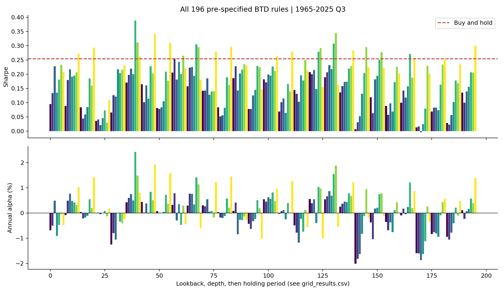
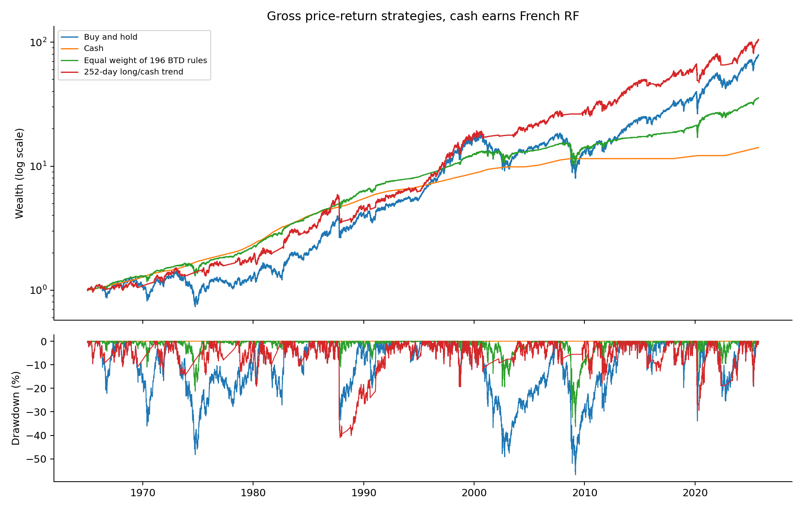
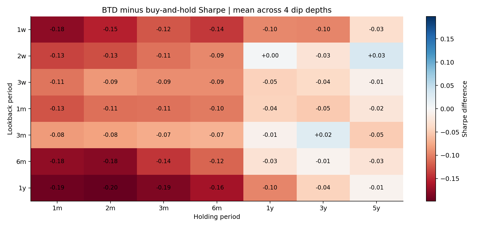
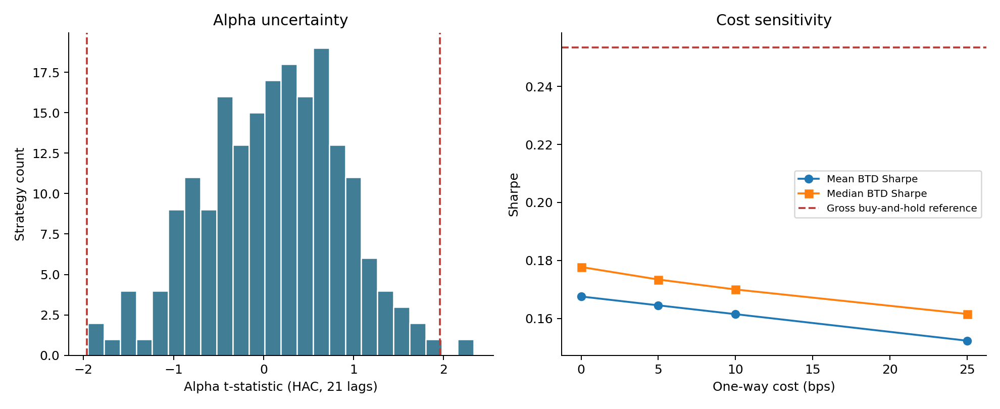

# 抄底有用吗？AQR《Hold the Dip》公开数据复现结果

更新日期：2026-11-09。主样本为 **1965-01-04 至 2025-09-30，共 15,288 个交易日**。

## 先看结论

使用公开的标普500价格与现金利率，本次196组抄底规则的平均夏普为 **0.168**，买入持有为 **0.254**；**171/196组（87.2%）**落后。平均年化alpha为 **0.086%**。HAC口径下有1组通过5%单项检验，经Holm多重检验校正后为0组。

这组实验支持“抄底规则整体难以改善风险调整后表现”的方向性判断。对个人项目而言，核心成果是把直觉写成清晰规则，完成数据与交易时序处理，用完整网格、成本和统计检验解释结果。

## 1. 与原文逐项比较

原文是AQR于2025-12-01发布的[《Hold the Dip》](https://www.aqr.com/insights/research/alternative-thinking/hold-the-dip)。下表原文数值来自[PDF第5—8页](https://www.aqr.com/-/media/AQR/Documents/Alternative-Thinking/AQR-Alternative-Thinking---Hold-the-Dip.pdf?sc_lang=en)；右列由本项目输出计算。

| 指标 | 原文 | 本次实测 |
|---|---|---|
| 策略数量 | 196 | 196 |
| 平均夏普减买入持有夏普 | 约-0.04 | -0.086 |
| 夏普落后的规则比例 | 超过60% | 87.2% |
| 平均年化alpha | 约0.5% | 0.086% |
| 传统t值绝对值超过1.96 | 16组 | 1组（本项目普通OLS） |
| HAC(21)的p值小于0.05 | 原文未明确此口径 | 1组 |
| Holm校正后p值小于0.05 | 本项目新增评价 | 0组 |

**复现程度：核心实验已完成，结论方向相符，数值仍有明显差异。** 本次用Yahoo价格和French 1M现金收益，原文用Bloomberg及3M现金基准；固定交易日换算、下一日收盘成交、忽略持仓中新信号也是本次具体设定。原文对部分实施细节描述较简略，现有证据可用于呈现差异，并为进一步对齐提供依据。

## 2. 收益、风险与仓位一起看

| 规则/基线 | 年化收益 | 年化波动 | 夏普 | 最大回撤 |
| --- | --- | --- | --- | --- |
| 买入持有 | 7.47% | 16.70% | 0.254 | -56.78% |
| 现金 | 4.46% | 0.20% | — | 0.00% |
| 回看1月/跌10%/持有3月 | 5.26% | 10.34% | 0.125 | -42.36% |
| 回看3月/跌10%/持有1年 | 7.43% | 13.19% | 0.279 | -52.47% |
| 回看1年/跌20%/持有5年 | 7.61% | 12.52% | 0.300 | -48.20% |
| 196规则每日等权组合 | 6.06% | 8.27% | 0.225 | -36.30% |
| 252日趋势基线 | 7.98% | 12.32% | 0.331 | -41.02% |

表内为主样本毛收益，股票采用价格收益，空仓资金获得French RF。三条示例规则覆盖短、中、长持有期，展示用途相同；全部196条规则在CSV中保留。每个年化收益按252交易日换算。

买入持有年化收益为7.47%，最大回撤为-56.78%。抄底规则的股票平均仓位在全网格上为25.9%，长期空仓的现金收益构成了策略回报的一部分。196规则组合的夏普为0.225，其计算方式是每天将资金等分给全部规则后取平均日收益。

趋势基线用“价格高于252日前价格则持股”的单一规则，夏普为0.331。这个基线帮助比较顺势与抄底的仓位路径；AQR原文的SG Trend部分使用另一组数据与策略范围。

图1：上图为196条规则的夏普与买入持有参照线，下图为市场回归年化alpha。排列顺序为回看期、跌幅、持有期，便于与grid_results.csv对应。

图2：对数净值和回撤。不同策略的股票暴露不同，同时观察收益增长和风险路径有助于理解这种差别。

## 3. 参数结构：短持有与长持有的差别

图3：横轴是持有期，纵轴是回看期，每格对四种跌幅取平均；数值为抄底夏普减买入持有夏普。全网格平均值为-0.086。

按持有期汇总，21日持有规则的平均夏普为0.111，1260日持有规则为0.237；对应平均股票仓位从8.5%上升到53.7%。延长持有期后，规则逐渐增加股票暴露，夏普也更接近买入持有。每格的细分参数和平均仓位可在grid_results.csv核对。全网格净开仓次数介于1和136次之间，评价具体参数时可将这些信息一起读。

## 4. 对实现方式敏感吗

| 重复信号处理 | 执行方式 | 平均夏普差 | 落后比例 |
| --- | --- | --- | --- |
| 持仓展期 | 信号下一收盘成交 | -0.069 | 73.0% |
| 忽略新信号 | 信号当日收盘成交近似 | -0.076 | 85.7% |
| 忽略新信号 | 信号下一收盘成交 | -0.086 | 87.2% |

三种实现下，整组规则平均夏普均低于买入持有。落后幅度和比例随实施方式发生变化，说明在复现中记录重复信号处理和成交时点有实际意义。主实验使用“下一日收盘成交、持仓期间忽略新信号”，以已经观察到的信号安排下一次收盘交易。

## 5. 费用与统计检验

| 单边成本/bps | 196组平均夏普 | 196组平均年化收益 | 196组平均最大回撤 |
| --- | --- | --- | --- |
| 0 | 0.168 | 5.81% | -42.51% |
| 5 | 0.164 | 5.77% | -42.58% |
| 10 | 0.161 | 5.74% | -42.66% |
| 25 | 0.152 | 5.63% | -42.91% |

表中“平均年化收益”和“平均回撤”为196条规则各自指标的算术平均。买入持有参照采用毛收益。单边成本是每次买入或卖出按资金比例扣除的简化费用，成本提高对高换手规则影响更明显。

图4：左侧是HAC(21)的alpha t值分布，右侧是四档单边成本下的平均及中位夏普。主实验平均年化alpha为0.086%，个体显著结果经过196项Holm校正后，达到5%水平的规则数为0。

回归截距回答在这一样本中、控制市场超额收益后，策略还有多少剩余收益。HAC和多重检验把时间依赖与多参数比较纳入同一评价流程，结果解释据此保持在当前样本和规则范围内。

## 6. 不同历史阶段与发布后观察

| 阶段 | 交易日数 | 196组平均夏普 | 买入持有夏普 | 落后比例 | 平均股票仓位 |
| --- | --- | --- | --- | --- | --- |
| 1965-1989 | 6285 | 0.107 | -0.002 | 12.2% | 25.6% |
| 1990-2009 | 5043 | 0.069 | 0.202 | 88.8% | 25.1% |
| 2010-2025Q3 | 3960 | 0.415 | 0.667 | 87.8% | 27.5% |
| 发布后观察 | 208 | 1.168 | 0.889 | 4.6% | 17.4% |

历史分段沿用原有仓位。阶段差异说明择时规则受市场路径影响，适合结合特定时期的波动和持仓记录继续分析。

发布后窗口是**2025-12-02至2026-09-30**，共208个交易日。该窗口展示固定规则在文章发布后的表现，报告同时呈现仓位和完整网格分布。窗口中的规则表现优劣以当前观察为范围，后续可按相同设定持续更新。

## 7. 看一笔交易，核对时间线

示例规则：回看21个交易日、跌幅达到10%、持有63个股票收益区间。前五条交易如下，完整清单在example_trades.csv。

| 信号日 | 下一收盘买入 | 首个股票收益日 | 卖出收盘日 | 持有交易日 | 该段股票收益 |
| --- | --- | --- | --- | --- | --- |
| 1966-08-29 | 1966-08-30 | 1966-08-31 | 1966-11-30 | 63 | 6.05% |
| 1970-04-28 | 1970-04-29 | 1970-04-30 | 1970-07-28 | 63 | -4.94% |
| 1973-11-26 | 1973-11-27 | 1973-11-28 | 1974-02-27 | 63 | 0.73% |
| 1974-07-08 | 1974-07-09 | 1974-07-10 | 1974-10-07 | 63 | -20.29% |
| 1974-10-04 | 1974-10-07 | 1974-10-08 | 1975-01-07 | 63 | 9.35% |

信号收盘之后，下一交易日收盘成交，再从随后的日收益开始计入股票敞口。逐日仓位文件可以核对每个买入、持有和退出区间。`holding_return_days`统计实际纳入的股票日收益数量；样本结束仍有仓位时，交易清单用open_at_sample_end标记。若到期时接续一个新持有周期，两个周期在同一次收盘衔接；股票净仓位保持不变，费用按净仓位变化计算。报告生成时，用逐个触发周期独立重建示例仓位，并与主程序输出逐日核对。

## 8. 已完成的复现与接下来可研究的问题

已完成公开数据下载和快照留存、196组主实验、收益风险评价、OLS与HAC回归、Holm校正、执行与成本敏感性、历史分段、发布后观察，以及6类针对时间与资金逻辑的自检。

进一步研究可优先考虑两项：取得原文相同的3M现金数据及更详细的持仓实现说明，量化各口径对差距的贡献；把同一研究问题扩展到含分红的可交易ETF，结合开盘成交数据重新评估费用和可执行性。每次扩展保留一个明确的问题和固定实验设定，方便解释新增证据。

完整方法与运行命令见[复现流程](../docs/复现流程.md)，原始数值见[grid_results.csv](grid_results.csv)，实际运行版本及自检记录见[summary.json](summary.json)。
