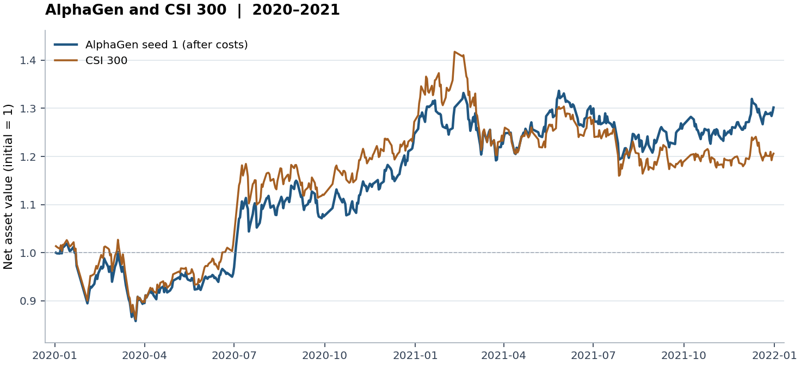

# AlphaGen 论文复现

复现 KDD 2023 论文《Generating Synergistic Formulaic Alpha Collections via Reinforcement Learning》中的 CSI300 实验。固定因子池容量为 10，seed 1 的测试 IC 为 **0.0648**，Rank IC 为 **0.0746**。在 2020—2021 年的 50/5 模拟交易中，组合扣费年化收益为 **14.68%**，相对沪深300的年化超额收益为 **3.46%**。[论文](https://arxiv.org/abs/2306.12964) · [作者代码](https://github.com/RL-MLDM/alphagen)

## 数据和因子搜索

股票范围为沪深300历史成分股，使用开、高、低、收、成交量和成交量加权均价六项特征。股票行情来自 BaoStock，前复权基准日为 2023-01-15，处理后载入 Qlib。预测目标为从当日收盘到未来第 20 个交易日收盘的收益。训练期为 2009—2018 年，验证期为 2019 年，测试期为 2020—2021 年。[论文 §4.1](https://arxiv.org/html/2306.12964v1#S4.SS1)

1. PPO 逐个生成公式记号，以动作掩码约束运算符、特征和常数的组合，使生成的序列可以解析为因子表达式。
2. 对各因子按交易日做截面标准化，用线性权重加总。新因子进入候选池后，结合因子与未来收益的相关性及因子之间的相关性，重新优化组合权重。池超过 10 个因子时，移除绝对权重最小的因子。
3. 用更新后组合的训练集 IC 作为强化学习奖励。seed 1 从头训练，目标步数 250,000，按完整 PPO 采样批次收尾，实际完成 **251,904 步**，最终保留 10 个因子。[论文 §3](https://arxiv.org/html/2306.12964v1#S3)

## 预测结果

IC 是因子分数与未来 20 日收益的每日截面 Pearson 相关系数，Rank IC 使用 Spearman 相关系数。表中报告各交易日的均值，ICIR 与 Rank ICIR 分别以对应的每日相关系数均值除以总体标准差，未做年化。

| 数据区间 | 交易日 | IC | Rank IC | ICIR | Rank ICIR |
|---|---:|---:|---:|---:|---:|
| 训练集 2009—2018 | 2,431 | 0.0931 | 0.0784 | 0.7448 | 0.6457 |
| 验证集 2019 | 244 | 0.0034 | 0.0345 | 0.0357 | 0.3135 |
| 测试集 2020—2021 | 486 | 0.0648 | 0.0746 | 0.6034 | 0.6709 |

| CSI300 测试指标 | 本次 seed 1 | 论文表 2 | 相对论文差距 |
|---|---:|---:|---:|
| IC | 0.0648 | 0.0725 | 低 10.6% |
| Rank IC | 0.0746 | 0.0806 | 低 7.5% |

论文主表报告 10 个种子的均值，因子池容量从 10、20、50、100 中选择。论文表 3 的单个 10 因子组合 IC 为 0.0511，本次 seed 1 高出 0.0137。[论文表 2](https://arxiv.org/html/2306.12964v1#S4.T2) · [论文表 3](https://arxiv.org/html/2306.12964v1#S4.T3)

## 模拟交易

组合目标持有 50 只股票，每日最多替换 5 只已有持仓。使用前一交易日的因子分数，在当日收盘价成交，并考虑交易状态和涨跌停约束。初始资金 1 亿元，买卖费率各 0.15%，每笔最低 5 元。基准为社区 Qlib 数据归档中的沪深300指数。持股数和替换数采用论文的回测设置。[论文 §4.4](https://arxiv.org/html/2306.12964v1#S4.SS4)

| 回测指标 | seed 1 |
|---|---:|
| 扣费年化收益 | 14.68% |
| 年化超额收益 | 3.46% |
| 夏普比率 | 0.7824 |
| 最大回撤 | -16.34% |
| 超额收益信息比率 | 0.3920 |
| 超额最大回撤 | -8.80% |

表中年化收益和回撤使用本地 Qlib 的加法收益口径，每年按 238 个交易日计。图中净值逐日复利累乘，策略和基准期末净值分别为 **1.302** 和 **1.206**。论文图 5 给出了净值曲线，以上统计值来自本次模拟交易。

## 不同种子的结果

七组都固定容量 10、目标步数 25 万和相同交易设置。seed 1 的测试 IC 和 Rank IC 均为七组最高，因此本文展示该组的完整结果。按照预先约定的 2019 年验证集 IC 选组，选中的是 seed 0，其测试 IC 为 0.0452。七组测试 IC 均值为 **0.0457**，Rank IC 均值为 **0.0505**。

| 种子 | 验证 IC | 测试 IC | 测试 Rank IC | 年化超额收益 |
|---|---:|---:|---:|---:|
| 0 | 0.0331 | 0.0452 | 0.0512 | +0.84% |
| 1 | 0.0034 | 0.0648 | 0.0746 | +3.46% |
| 2 | -0.0136 | 0.0472 | 0.0519 | -2.74% |
| 3 | -0.0155 | 0.0507 | 0.0548 | -2.47% |
| 4 | -0.0347 | 0.0255 | 0.0209 | -0.81% |
| 5 | 0.0022 | 0.0495 | 0.0642 | +6.47% |
| 6 | -0.0067 | 0.0370 | 0.0361 | +1.51% |

## 结果文件

| 文件 | 内容 |
|---|---|
| [seed1_metrics.json](seed1_metrics.json) | 实验参数、各数据区间的预测指标和回测统计 |
| [seed1_pool.json](seed1_pool.json) | 最终因子池的 10 条公式及对应权重 |
| [seed1_nav.csv](seed1_nav.csv) | 逐日扣费策略净值与沪深300基准净值 |
